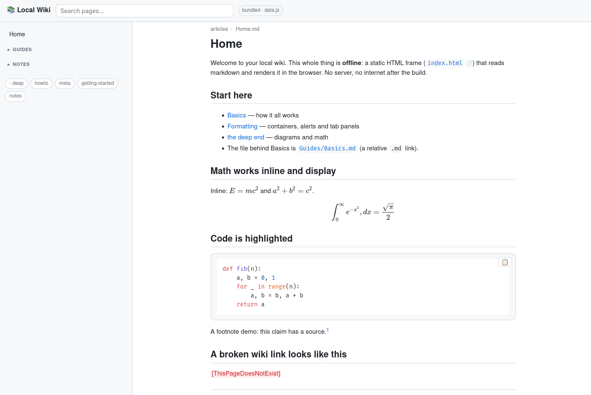
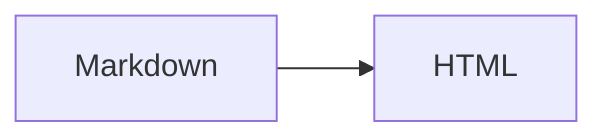

# Bare-metal Markdown Wiki

This is a wiki that runs entirely in your browser, on a folder of plain Markdown files.

**No server. No runtime. No build dependencies. No network.** 

The site is one static HTML frame (`index.html` + `app.js`) that reads `.md` files and renders
them on the fly. Clone it, open `index.html`, done — it works offline, and it
works from a plain `file://` double-click.



## Features

**Wiki**

- Automatic home page — recent edits (by mtime) + all pages grouped by folder
- Subfolders — nested Markdown directories, mirrored in the sidebar as
  collapsible groups
- `[[WikiLinks]]` — `[[Page]]`, `[[Page|alias]]`, `[[subfolder/page]]`, plus
  regular `.md` links; unresolvable links are visibly marked
- Backlinks panel under every page
- Frontmatter **tags** with one-click filtering
- Live full-text search (result cap set in the settings block)
- Per-page table of contents — placement set in the settings block:
  *left* (sidebar, under the page's file name) or *right* (rail beside the article)
- Hash routing — `#path/to/page` deep links, browser back/forward work
- External links (`http…`, `mailto:`) open in a new tab, marked with a ↗
- Resizable sidebar — drag the strip between sidebar and article; the width
  is remembered in the browser (localStorage), not in the settings file

**Markdown extras**

- Syntax-highlighted code blocks (highlight.js)
- Math via KaTeX — `$…$`, `$$…$$`, `\(...\)`
- Mermaid diagrams — `` ```mermaid `` fenced blocks
- Local images — `` resolves against the page's folder and loads
  lazily from the `articles/` files (`data.js` stays text-only); in live-render
  mode they are read from the picked folder; `http(s)` sources load normally;
  `png` `jpg` `gif` `svg` `webp`
- Footnotes — `[^1]: …` at the bottom of the file

## Quick start

```bash
git clone https://github.com/Sarki/bare-metal-markdown-wiki.git
cd bare-metal-markdown-wiki
# open index.html in your browser
```

A small sample knowledge base in `articles/` demonstrates every feature.

### Adding content

1. Drop or edit `.md` files anywhere inside `articles/` (subfolders allowed)
2. Rebuild the snapshot:

   ```bash
   ./build.sh          # Linux/macOS — pure bash, offline
   build.bat           # Windows — double-click, offline
   ```

3. Reopen `index.html` (or just refresh — the snapshot is read at load)

That's the entire workflow. The build walks `articles/`, embeds every file
(plus its mtime) into `data.js`, and touches nothing else. No npm, no Python,
no network access.

### Live render (Chrome / Edge)

Instead of rebuilding, you can point the wiki directly at a folder on disk.

- Click **Live render** in the top bar (only shown in browsers with the
  [File System Access API](https://developer.mozilla.org/en-US/docs/Web/API/File_System_API) —
  Chrome/Edge)
- Pick your Markdown folder **once**; the choice is remembered (IndexedDB) and
  reused on every later open
- The folder is **re-read automatically when the tab regains focus**, plus a
  **↻** button for manual refresh — the closest a serverless `file://` page
  can get to a file watcher

Browsers cannot let a `file://` page read sibling folders without a one-time
user grant; that is the one unavoidable click. In Firefox/Safari the button
is hidden and the bundled snapshot is used instead.

## Settings

Local-first means settings live in the file, not in the UI. Edit the marked
block at the top of `index.html`:

```html
window.WIKI = {
  maxResults: 200,   // maximum number of search results to display
  tocSide: 'left',   // 'left' (sidebar) or 'right' (rail beside the article)
  tocLevels: 3,      // heading levels shown in the TOC (H1..Hn); 1–6
  pageWidth: 70,     // article column width as % of the reading area; 10–100
  foldersOpen: false, // start with the sidebar folders expanded (false = all collapsed)
  landingPage: 'Home', // page opened on load (a slug like 'Guides/Basics'); '' = generated home
  sidebarOrder: 'files', // 'files' (pages then folders) | 'folders' | 'alpha' (mixed alphabetical)
  badgeColors: {     // first words of @{ badges } that get a color
    green: ['stable', 'ok', 'done', 'active', 'success', 'passed', 'shipped', 'final'],
    yellow: ['draft', 'wip', 'todo', 'pending', 'review', 'progress', 'untested'],
    red: ['error', 'failed', 'fails', 'failing', 'broken', 'danger', 'urgent', 'deprecated'],
    blue: ['info', 'new', 'beta', 'note', 'preview'],
    purple: ['alpha', 'experimental', 'planned', 'idea']
  }
};
```

## Markdown conventions

Frontmatter (optional):

```yaml
---
title: My Page            # else: first H1, else filename
tags: one, two            # inline list — or a YAML list
---
```

Everything else is standard Markdown, plus:

````markdown
Inline math $a^2+b^2=c^2$, display math:

$$\int_0^1 x\,dx = \tfrac{1}{2}$$


````

A footnote.[^1]

[^1]: Written at the bottom of the file.

GitHub-style alerts (note, tip, important, warning, caution):

> [!NOTE]
> A boxed callout. A custom title after the marker is allowed.

Block containers (any name):

```
::: tip
Anything between the markers, styled by the name.
:::
```

Tab panels (button bar, first tab active by default):

````
::: tabs
::: tab: Node
```js
console.log('tabbed');
```
:::
::: tab: Python
```python
print('tabbed')
```
:::
:::
````

Inline badges (small pill, anything between `@{` and `}`; known statuses like `draft` or `stable` get a color — word list in the settings block):

```markdown
This page is @{draft} and the plugin is @{v1.0} stable.
```


Link resolution:

- `[[Stem]]` (no slash) matches any file stem in the whole KB,
  case-insensitively; `[[Stem|alias]]` changes the displayed text. If
  several files share a stem, the shallowest one wins.
- `[[sub/name]]` (with a slash) is an exact path from the `articles/` root —
  no `..`, case-sensitive.
- Plain `.md` links are relative to the current page's folder
  (`./` and `../` work; a leading `/` is root-absolute), case-sensitive.

## How it works

```
articles/*.md ──build.sh──▶ data.js ─┐
                                     ├─▶ index.html + app.js (render in browser)
folder ──File System Access API──────┘
```

- `data.js` is a plain array of `{slug, mtime, content}` — content base64'd,
  decoded in JS. The build can stay trivial because titles/tags are parsed at
  load time, never at build time.
- `slug` is the page path relative to `articles/` and doubles as the URL
  fragment (`#Guides/Basics`).
- Render pipeline: frontmatter → `[[wiki]]`/`.md` link rewriting →
  markdown-it + footnotes → KaTeX auto-render → highlight.js → mermaid.
- All libraries are vendored in `vendor/` (single-file UMD builds, no dynamic
  imports) so the site never needs the internet. To upgrade a library,
  download its new release file and replace it — no build or install step.
  One exception: `vendor/mdit-extras.js` (the `:::` container + `> [!NOTE]`
  alert plugins, written against markdown-it's internal block-rule API) can
  break if you swap `markdown-it.min.js`; re-run `node test-render.js`
  after any vendor change.

## Project layout

```
index.html        the frame (layout + UI chrome, no logic)
style.css         styling
app.js            all logic: loaders, renderer, search, navigation
data.js           generated snapshot of articles/ (rebuild, don't edit)
build.sh          offline rebuild — bash
build.bat         offline rebuild — Windows
articles/         the knowledge base (sample pages included)
vendor/           markdown-it, mdit-extras, highlight.js, KaTeX (+fonts), mermaid
test-render.js    smoke test: node test-render.js (run after upgrading vendor/)
test-app.js       smoke test: node test-app.js (link/footnote source passes)
```

## Limitations

- Live render: Chrome/Edge only; the remembered folder is per-browser and per-origin,
  and some Chrome builds on `file://` may re-ask for permission between sessions
- Search is substring matching — plenty for a local KB
- Bundled mode is a snapshot: new pages need a rebuild (or use live render)
- Bundled images are plain files: keep the `articles/` folder next to `index.html` (the wiki folder is the unit you copy or serve)

## Disclaimer

This was developed with the help of a local LLM.
