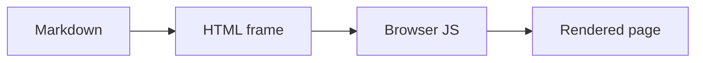

# Advanced

Tags here are written as a YAML **list** (one per line). This page also has
`diagrams` and `deep` tags, and links to [[Basics]] and [[Home]].

## Mermaid diagram



## Display math

$$\sum_{n=1}^{\infty} \frac{1}{n^2} = \frac{\pi^2}{6}$$

Inline math: $e^{i\pi} + 1 = 0$.

## A little shell

```bash
# rebuild the bundled snapshot (offline)
./build.sh
```

## Callouts

> [!WARNING]
> Rebuilding **overwrites** `data.js`. Keep it in version control and
> rebuild after every change to the articles.

Next: [[Basics]].
